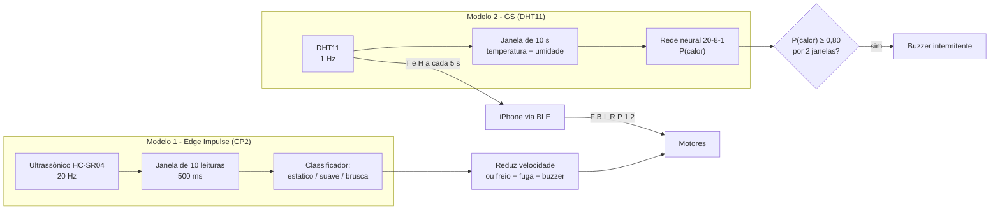

# Carrinho Pokébola — Carrinho-robô com TinyML (CP1 → CP2 → GS)

> Carrinho-robô de carenagem esférica (estilo pokébola), controlado por celular via BLE, com **dois modelos de IA embarcados no ESP32**:
> 1. **Classificação de aproximação** com o sensor ultrassônico (HC-SR04): reconhece *como* um obstáculo se aproxima e reduz a velocidade ou foge;
> 2. **Classificador de fogo/calor** com o sensor DHT11 (sensor adicional da Global Solution): reconhece o padrão de aquecimento e aciona um alarme sonoro.
>
> Tudo roda dentro do microcontrolador, sem internet.

**Turma:** 4ESPY · **Disciplina:** Project Maker Lab

## Integrantes

| Nome | RM |
|---|---|
| João Vieira | RM 99805 |
| Lucas Speranzini | RM98297 |


---

## 1. Linha do tempo: CP1 → CP2 → GS

O projeto é **um único carrinho que evoluiu em três entregas**. Não foi construído um carrinho novo em nenhuma delas.

| Etapa | O que o carrinho ganhou | IA |
|---|---|---|
| **CP1** | Carrinho 2WD controlado pelo iPhone via BLE (L298N + 2 motores), sensor ultrassônico de ré com buzzer (`se distância ≤ 5 cm → apita`), músicas e LED | Nenhuma (regra fixa por limiar) |
| **CP2** | O mesmo carrinho, agora com **TinyML no ESP32 (Edge Impulse)**: o ultrassônico alimenta um classificador que decide entre manter, reduzir a velocidade ou frear e fugir | Modelo 1: tipo de aproximação |
| **GS** | **Sensor adicional DHT11** (temperatura e umidade) com telemetria BLE e um **segundo modelo de IA** que detecta calor anormal e aciona o buzzer. Os dois modelos convivem no mesmo firmware | Modelo 2: classificador de fogo/calor |

O histórico de commits deste repositório registra essa evolução. O código do CP1 está nos commits anteriores, o do CP2 em `src/Carrinho/carrinho_tinyml/` e o da GS em `src/Carrinho/carrinho_dht_tinyml/`.

## 2. Problema (contexto CitizenTech)


Focos de calor e princípios de incêndio em depósitos, escombros, galpões e outros locais de difícil ou perigoso acesso só costumam ser percebidos quando já estão avançados. Mandar uma pessoa verificar o local expõe o cidadão e as equipes de resposta a risco desnecessário.

**Nossa proposta:** um robô de baixo custo, conduzido à distância, que se move com segurança (sem bater, graças ao modelo de aproximação) e mede temperatura e umidade. Com IA embarcada, ele **reconhece o padrão de aquecimento** (temperatura sobe e umidade cai) e **alerta quem está por perto**.

## 3. Visão geral da solução



| Função | Como é feita |
|---|---|
| Controle do carrinho | App no iPhone envia comandos por BLE |
| Anticolisão de ré (CP2) | Ultrassônico na traseira + modelo 1 decidem entre manter, reduzir a velocidade ou frear e fugir |
| Telemetria (GS) | O DHT11 envia temperatura e umidade ao iPhone a cada 5 s por BLE |
| **Detecção de calor (GS)** | O modelo 2 classifica a janela de 10 s do DHT11; se `calor`, o buzzer apita de forma intermitente |

## 4. Hardware

### Componentes

| # | Componente | Função |
|---|---|---|
| 1 | ESP32 (DevKit) | Lê sensores, roda os dois modelos, controla motores e BLE |
| 2 | Módulo L298N (ponte H dupla) | Aciona os motores |
| 3 | 2 motores DC com redução 1:48 (3–6 V) | Tração |
| 4 | 2 rodas 70 × 26 mm + 1 roda boba | Locomoção |
| 5 | **Sensor ultrassônico HC-SR04** | Distância do obstáculo (fica na **traseira**) |
| 6 | **Sensor DHT11** | **Sensor adicional da GS**: temperatura e umidade |
| 7 | Buzzer | Alarme de emergência (ré) e alarme de calor |
| 8 | LED (GPIO 2) | Indicação de status |
| 9 | Suporte de pilhas | Alimentação |
| 10 | Chassi interno de madeira (corte a laser) | Estrutura |
| 11 | Carenagem esférica de PLA, base + tampa (Bambu Lab A1) | Visual "pokébola" e proteção |
| 12 | Jumpers e abraçadeiras | Ligações e organização dos fios |

Lista mecânica completa em [`hardware/lista-componentes.md`](./hardware/lista-componentes.md).

### Pinagem

| Sinal | GPIO |
|---|---|
| HC-SR04 TRIG | 5 |
| HC-SR04 ECHO | 4 (use divisor de tensão: o ECHO sai em 5 V) |
| Buzzer | 18 |
| LED | 2 |
| **DHT11 (dados)** | **19** |
| Motor esquerdo (IN1 / IN2) | 25 / 33 |
| Motor direito (IN1 / IN2) | 32 / 26 |

### Documentação de hardware
- [Ficha de requisitos](./hardware/ficha-requisitos.md)
- [Mudanças na estrutura do chassi](./hardware/mudancas-estrutura-chassi.md)
- [Conexões eletrônicas](./hardware/conexoes-eletronicas.png) · [Diagrama de alimentação](./hardware/diagrama-alimentacao.png)
- [Croqui do chassi](./croqui-chassi.png)
- Modelos 3D (feitos no Fusion) em [`stl/`](./stl): `baixo.stl`, `Centro.stl`, `cima.stl`

## 5. Modelo 1 — Classificação de aproximação com o ultrassônico (CP2)

O ultrassônico traseiro mede a distância a 20 Hz. O modelo recebe as **últimas 10 leituras (500 ms)** e classifica **como** o obstáculo se aproxima, e não apenas quão perto ele está.

| Classe | O que é |
|---|---|
| `aproximacao_suave` | A distância diminui devagar e de forma constante |
| `aproximacao_brusca` | A distância cai drasticamente em poucos ms |
| `estatico` | A distância não muda |

**Regras de ação** (valem só **de ré**, pois o sensor é traseiro):

| Situação | Ação |
|---|---|
| De ré, algo a mais de 20 cm | Nada |
| De ré, entre 5 e 20 cm, e o modelo diz `suave` ou `brusca` (P(suave)+P(brusca) ≥ 0,50) | Reduz a velocidade (PWM): `suave` gradual, de 100 % a 45 %; `brusca` direto em 45 % |
| De ré, entre 5 e 20 cm, e o modelo diz `estatico` | Mantém a velocidade |
| De ré, a 5 cm ou menos (2 leituras seguidas) | Freio + buzzer + vai para **frente** por 1 s |
| Qualquer outra direção | Nada |

### Dataset

- **Sensor:** HC-SR04 na traseira (TRIG = 5, ECHO = 4).
- **Dado:** distância em cm (1 eixo) com `timestamp` em ms, a **20 Hz**; sem eco = 200 cm.
- **Origem: simulação.** Trajetórias de distância geradas por script (semente 42) com as características do sensor: ruído gaussiano de ~0,3 cm, resolução de 0,1 cm, saturação em 200 cm, falhas de eco (0,4 %) e jitter de 0–2 ms. O rótulo vem do nome do arquivo (`<classe>.simNNN.csv`).

| Classe | Arquivos CSV | Amostras | Tempo |
|---|---|---|---|
| estatico | 16 | 3200 | 160 s |
| aproximacao_suave | 16 | 3200 | 160 s |
| aproximacao_brusca | 40 | 1200 | 60 s |
| **Total** | **72** | **7600** | **380 s** |

**Limitação:** um modelo treinado só com dados simulados pode errar com o sensor real (o ruído, o eco e a vibração dos motores são diferentes). O fluxo de coleta real permite retreinar sem mudar o firmware.

### Edge Impulse

| Item | Valor |
|---|---|
| Projeto | `JPSV-project-1` |
| Janela / incremento / frequência | 500 ms / 100 ms / 20 Hz (10 amostras) |
| Processamento | Raw data |
| Aprendizado | Classification (2 camadas densas, 20 e 10 neurônios) |
| Divisão treino/teste | [..% / ..%] |
| Acurácia de validação / teste | [..%] / [..%] |
| Exportação | Arduino library (quantizada int8) |

Prints do treino, da matriz de confusão e do teste em [`edge_impulse/`](./edge_impulse).

## 6. Modelo 2 — Classificador de fogo/calor com o DHT11 (GS)

O DHT11 é o **sensor adicional** da GS. Ele lê temperatura e umidade a 1 Hz e um segundo modelo decide se o ambiente está aquecendo de forma anormal.

| Item | Valor |
|---|---|
| Tarefa | Classificação binária de série temporal |
| Classes | `normal` e `calor` |
| Entrada | Janela de 10 s × (temperatura, umidade) = 20 valores |
| Arquitetura | Rede neural 20 → 8 → 1 (ReLU + sigmoide), 177 parâmetros |
| Treino | [`src/dht/treinar_dht.py`](./src/dht/treinar_dht.py) (Python + NumPy, Adam) |
| Embarque | Pesos em [`dht_modelo.h`](./src/Carrinho/carrinho_dht_tinyml/dht_modelo.h); inferência em C++ puro dentro do ESP32 |

**Por que este modelo não está no Edge Impulse:** chegamos a treinar um impulse do DHT11 no Edge Impulse (`src/Carrinho/ei-dht_calor-arduino-1.0.1-impulse-#1.zip`, usado na versão intermediária `Carrinho.ino`). Porém cada biblioteca exportada traz sua própria cópia do SDK, e duas delas no mesmo sketch (a do ultrassônico e a do DHT11) causam centenas de erros `multiple definition` no link. Rodar vários impulses juntos exige o recurso multi-impulse, que está em *developer preview* e só para a biblioteca C++. Por isso mantivemos o Edge Impulse no modelo 1 e embarcamos o modelo 2 diretamente, com os pesos exportados do Python.

### Dados

| Classe | Condição | Valores medidos |
|---|---|---|
| `normal` | Ambiente controlado, sem fonte de calor | T ≈ 25,5 °C, H ≈ 50–55 % |
| `calor` | Isqueiro aceso a 5–10 cm do sensor | T ≈ 28–29 °C, H ≈ 45 % |

- **Origem dos dados:** [PREENCHA COM HONESTIDADE: coletados com o DHT11 / sintéticos gerados por `gerar_dados_sinteticos.py` / mistura dos dois]
- **Quantidade:** [N] clipes `normal` e [N] clipes `calor` de 30 s a 1 Hz.
- **Divisão:** 80 % dos clipes para treino e 20 % para teste (por clipe, para não vazar janelas).
- CSVs em [`src/dht/dados/`](./src/dht/dados) (colunas `timestamp`, `temperatura`, `umidade`).

### Resultados (saída do `treinar_dht.py`)

| Métrica | Valor |
|---|---|
| Acurácia de treino | [..%] |
| Acurácia de teste | [..%] |
| Clipes `normal` com alarme falso (histerese do firmware) | [../..] |
| Clipes `calor` em que o alarme disparou | [../..] |

```
[COLE AQUI a matriz de confusão impressa pelo treinar_dht.py]
```

## 7. Integração dos sensores com a IA

### DHT11 → modelo 2 → buzzer (GS)
1. **Leitura:** a cada 1 s o ESP32 lê temperatura e umidade (1 Hz é o limite do DHT11). Se a leitura falha, repete a última válida para manter o ritmo.
2. **Janela deslizante:** as últimas 10 leituras (20 valores intercalados `T0,H0,T1,H1,...`) ficam num buffer que anda uma posição por segundo.
3. **Inferência:** a rede neural devolve **P(calor)**.
4. **Decisão com histerese:** o alarme liga após **2 janelas seguidas** com P(calor) ≥ 0,80 e desliga após **3 seguidas** abaixo disso, o que evita falso alarme por uma leitura isolada.
5. **Ação:** o buzzer toca 250 ms ligado / 250 ms desligado, sem travar o loop. O alarme é independente do controle: continua tocando com o carrinho parado ou o celular desconectado.

### Ultrassônico → modelo 1 → motores (CP2)
Leitura a 20 Hz (sem `delay`) → janela de 10 amostras → `run_classifier()` → regra de ação da seção 5.

### Convivência dos dois modelos
- O buzzer é compartilhado: a **emergência de ré** e a **vinheta de início** têm prioridade, e o alarme de calor retoma sozinho quando elas terminam.
- A leitura do DHT11 bloqueia o loop por ~20 ms uma vez por segundo; isso atrasa levemente uma amostra do ultrassônico (20 Hz) e foi aceito.
- Se o celular desconectar, o carrinho para, mas o alarme de calor continua ativo.

Trecho principal do alarme (`carrinho_dht_tinyml.ino`):

```cpp
pCalor = dhtProbCalor(janelaDHT);                      // rede neural -> P(calor)
if (pCalor >= LIMIAR_CALOR) { seqCalor++; seqNormal = 0; } else { seqNormal++; seqCalor = 0; }
if (!alertaCalor && seqCalor  >= CONFIRMA_ALERTA) alertaCalor = true;
if ( alertaCalor && seqNormal >= CONFIRMA_NORMAL) alertaCalor = false;
...
atualizarAlarmeCalor();                                // buzzer intermitente se alertaCalor
```

## 8. Como instalar e executar

### Requisitos
- Arduino IDE 2.x e placa **esp32 (Espressif) 3.x** instalada no Gerenciador de Placas
- Bibliotecas (Gerenciador de Bibliotecas): **DHT sensor library** e **Adafruit Unified Sensor**
- Biblioteca do Edge Impulse do **modelo 1** (`JPSV-project-1_inferencing`), exportada do projeto no Edge Impulse
- Python 3 com `pip install numpy pyserial` (só para coleta e treino do modelo 2)

### Passo a passo
1. Clone o repositório.
2. Instale a biblioteca do modelo 1: *Sketch → Include Library → Add .ZIP Library*.
   **Deixe só uma biblioteca `*_inferencing` instalada.** Remova de `Documentos\Arduino\libraries` qualquer outra, como a `dht_calor_inferencing`.
3. Abra `src/Carrinho/carrinho_dht_tinyml/carrinho_dht_tinyml.ino`. O `dht_modelo.h` precisa estar na mesma pasta.
4. *Tools → Board → ESP32 Dev Module* e *Partition Scheme → Huge APP (3MB No OTA)*.
5. Compile e envie. No Monitor Serial (115200) aparecem `[CALOR] enchendo janela (n/10)` e, depois de 10 s, `[CALOR] ... P(calor)=...`.
6. No iPhone, conecte ao dispositivo BLE **`ESP32_iPhone`** e envie `1` para liberar o movimento.

### Comandos BLE

| Comando | Ação |
|---|---|
| `1` | Toca a vinheta e libera o movimento |
| `F` / `B` | Frente / ré (continua até outro comando) |
| `L` / `R` | Direita / esquerda (invertidos de propósito, como no CP1) |
| `P` | Para |
| `2` | Para e bloqueia o movimento |

Se o celular desconectar, o carrinho para e volta a anunciar o BLE.

### Testar o alarme de calor
Acenda um isqueiro a 5–10 cm do DHT11 (**nunca na chama**: o sensor é de plástico e derrete). Em alguns segundos a temperatura sobe, `P(calor)` aumenta e o buzzer passa a apitar. Afastando o isqueiro, o alarme desliga depois de 3 janelas sem calor.

### Refazer o modelo 2 com dados novos
1. Carregue `src/dht/dht_coleta/dht_coleta.ino` no ESP32.
2. Grave os clipes (feche o Monitor Serial antes):
   `python src/dht/gravar_csv_dht.py --porta COM3 --label normal --clips 20 --duracao 30 --pasta src/dht/dados`
   `python src/dht/gravar_csv_dht.py --porta COM3 --label calor --clips 20 --duracao 30 --pre 8 --descanso 60 --pasta src/dht/dados`
3. Treine e exporte os pesos:
   `python src/dht/treinar_dht.py --dados src/dht/dados --origem "dados reais do DHT11" --saida src/Carrinho/carrinho_dht_tinyml/dht_modelo.h`
4. Recompile e envie o sketch. Não é preciso mexer no código.

## 9. Estrutura do repositório

```
.
├── README.md
├── croqui-chassi.png
├── WhatsApp Video 2026-10-28 at 23.09.41.mp4
├── hardware/
│   ├── ficha-requisitos.md
│   ├── lista-componentes.md
│   ├── mudancas-estrutura-chassi.md
│   ├── conexoes-eletronicas.png
│   └── diagrama-alimentacao.png
├── stl/                                    # carenagem pokébola (Fusion)
│   ├── baixo.stl · Centro.stl · cima.stl
│   └── Fusion.md
├── organização/                            # MVP, MoSCoW, backlog, kanban, custos
├── edge_impulse/                           # prints do modelo 1 (CP2)
└── src/
    ├── Carrinho/
    │   ├── carrinho_dht_tinyml/            # FINAL (GS): modelos 1 e 2
    │   │   ├── carrinho_dht_tinyml.ino
    │   │   └── dht_modelo.h                # pesos do modelo 2 (gerado)
    │   ├── carrinho_tinyml/carrinho_tinyml.ino   # CP2: só o modelo 1
    │   ├── Carrinho.ino                    # versão intermediária: só o DHT11 (Edge Impulse)
    │   ├── fireRed.ino · fireRedIntro.ino · hobbits.ino · musica.ino   # abas de música do Carrinho.ino
    │   └── ei-dht_calor-arduino-1.0.1-impulse-#1.zip   # experimento no Edge Impulse (não instalar junto com a do modelo 1)
    └── dht/
        ├── dht_coleta/dht_coleta.ino       # coleta de dados do DHT11
        ├── gravar_csv_dht.py               # grava CSVs rotulados
        ├── gerar_dados_sinteticos.py       # dados de teste do pipeline
        ├── treinar_dht.py                  # treina e gera dht_modelo.h
        └── dados/                          # CSVs do DHT11
```

## 10. Organização do projeto

- [MVP](./organização/mvp.md) · [MoSCoW](./organização/moscow.md) · [Backlog](./organização/backlog.md) · [Dependências](./organização/dependencias.md) · [Kanban](./organização/kanban.md)
- [Planilha de custos](./organização/planilha-custos.xlsx)

## 11. Limitações e próximos passos

- **Dados:** o modelo 1 foi treinado com dados simulados; o modelo 2 com [dados reais / sintéticos: AJUSTE]. Em ambos, o desempenho com o sensor real pode ser menor que o medido no treino.
- O DHT11 responde devagar, tem resolução baixa e erro de ±2 °C; por isso a janela é de 10 s e o alarme leva alguns segundos.
- O modelo 2 aprende os valores do ambiente de coleta; em outro local (temperatura-base diferente) é preciso recoletar e retreinar.
- A fonte de calor testada foi um isqueiro a curta distância; não é um detector de incêndio certificado.
- Próximos passos: sensor de fumaça/gás (MQ-2) como entrada adicional, enviar o alerta de calor ao celular por BLE e unificar os dois modelos num único impulse (multi-impulse).

## 12. Referências

- Edge Impulse — https://docs.edgeimpulse.com
- Multi-impulse (C++) — https://docs.edgeimpulse.com/docs/multi-impulse
- Biblioteca DHT (Adafruit) — https://github.com/adafruit/DHT-sensor-library
- Documentação do ESP32 para Arduino — https://docs.espressif.com/projects/arduino-esp32